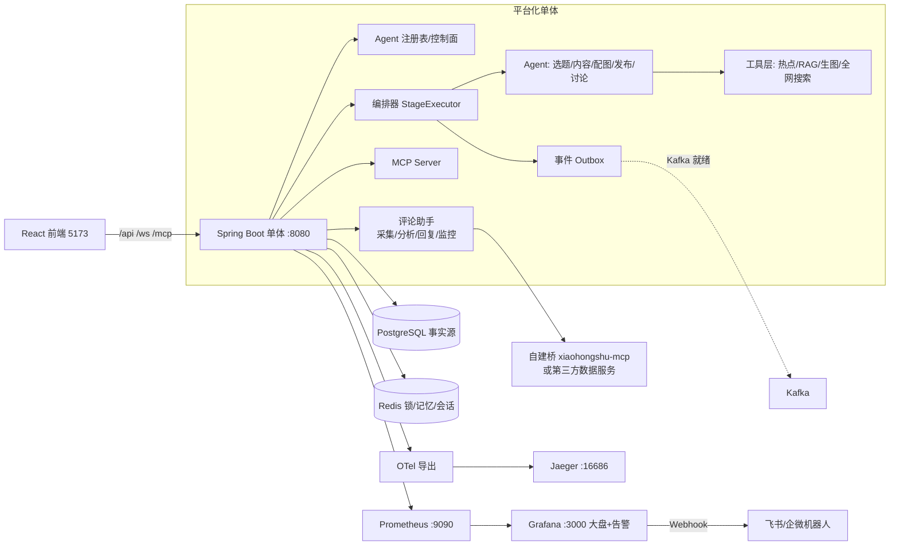

# Content Ops — 多 Agent 内容运营平台

> AI 驱动的多平台内容运营平台：**热点追踪 → 选题 → 内容 → 配图 → 发布** 的生产流水线，
> 以及发布之后的 **评论助手**（评论采集 / 意图识别 / 关系标签 / AI 起草 / 真实回复）。
> 按大厂标准建设：多 Agent 协作、MCP / A2A、OTel / Prometheus / Grafana、LLM-as-Judge、RBAC、成本熔断、容器化。

## 一、核心能力

| 模块 | 能力 |
|------|------|
| 内容生产 | 选题 → 内容 → 配图 → 发布的 4 阶段流水线，人机协同（平台选择/大纲/风格确认）、多平台并行扇出、按平台出产物、ZIP 下载 |
| 评论助手 | 评论采集（真实接口/模拟，可插拔数据源）、通知增量、意图语料库 RAG 前置识别、情感/摘要、关系标签（粉丝/关注/好友/常客/路人）、附件（图片/视频）与归属、多轮 AI 起草、人工审核、真实回复、定时采集与票据预警 |
| 场景客服回复 Agent | 可插拔场景配置（电商带货 / 课程模板 / 通用客服，新增场景不改代码）、按场景生成回复草稿、**忠实度校验只标记不修正**（禁止承诺 / 未核实价格·促销·时效 / 漏提示转人工 / 外链 / 超长），高置信度进复核清单、中低置信度抽样、人工复核状态机 |
| 多账号凭据 | 按租户归属的平台账号凭据（AES-GCM 加密、掩码出参、跨租户 403）、连通性探测、密钥轮换、采集/回复/通知全部按凭据走 |
| 热点监控 | 7 平台真实热榜（60s + newsnow 多路降级）、关键词启停与命中记录、AI 相关性/真假/摘要分析、突发热点检测、时间范围筛选、趋势曲线与平台对比 |
| 实时通知 | WebSocket 推送、邮件（SMTP 可配）、Grafana Alerting → 飞书/企业微信机器人、票据预警卡片（带直达按钮） |
| 全网搜索 | 热榜内搜索 + Tavily 全网/新闻聚合（可配） |
| RAG | 文档摄入、BM25+向量混合检索、重排、HyDE/Multi-query、RAGAS 评测；评论意图语料库（本地 BGE 中文嵌入，无需外部 Key） |
| 知识库问答 + RAG 错误识别 | 检索充分性判断 + 接地生成（强制引用）+ 引用校验 + **答案-证据忠实度校验（只标记不修正）** + 用户隐式信号归因 + 离线聚类找盲区与回归集；高风险进人工复核清单，中低置信度抽样 |
| 外部 Agent（CrewAI） | 独立 Python 研究 crew（研究员→策划→事实核查三角色），通过平台工具做选题研究；平台侧统一发起、产出回写知识库进检索与评测面；容器化运行，另带 `lite` 执行器便于对比与降级 |
| 多平台发布（MCP） | 各平台发布接社区现成 MCP server（抖音 CDP 自动化 / 小红书 HTTP+MCP / 公众号文颜），自研 MCP 客户端支持 stdio 与 Streamable HTTP 双传输；作品字段按配置映射到工具参数；未配置或调用失败**明确返回未上传**，不伪造成功 |
| 发布通道回落（影刀 RPA） | 平台可配 `channel: auto\|mcp\|rpa`：原生 MCP 失败自动回落影刀 RPA（官方 MCP Server，真实 UI 操作）；开放 API 模式的异步作业自动轮询 `queryJob` 到成功/失败/超时 |
| Agent 平台 | Agent 注册表控制面、MCP Server（/mcp）、A2A 事件契约、事件 Outbox（Kafka 就绪）、崩溃恢复 |
| 可观测 | OTel 分布式追踪（Jaeger）、LLM token/成本/延迟大盘（Prometheus + Grafana）、LLM trace 表（关联 traceId） |
| 评测与治理 | LLM-as-Judge 流水线自动判分 + CI 门禁、JWT + RBAC（ADMIN/CREATOR/VIEWER）、操作审计、安全护栏、成本熔断与预算告警 |

## 二、架构



## 三、快速开始

### Docker（推荐）

```bash
cp content-ops-configs/.env.example content-ops-configs/.env
# 编辑 .env：POSTGRES_PASSWORD / REDIS_PASSWORD / 模型 Key
docker compose -f content-ops-configs/docker-compose.yml up -d --build
```

访问：前端 http://localhost:5173 · 后端 http://localhost:8080/api/v1/health ·
Jaeger http://localhost:16686 · Grafana http://localhost:3000

### 本地（无 Docker）

```bash
powershell -ExecutionPolicy Bypass -File scripts/pg-manage.ps1 start      # PostgreSQL 5433
powershell -ExecutionPolicy Bypass -File scripts/start-backend.ps1        # 后端 8080
cd content-ops-frontend/content-ops-frontend && npm run dev               # 前端 5173
powershell -ExecutionPolicy Bypass -File scripts/observability-manage.ps1 start  # Prometheus/Grafana
```

### 模型配置

文本模型走 OpenAI 兼容端点，通过 `DASHSCOPE_API_KEY` / `DASHSCOPE_BASE_URL` / `LLM_MODEL` 配置
（默认 `qwen-flash`，切 DeepSeek 只需把 base-url 指向 `https://api.deepseek.com` 并把 `LLM_MODEL` 设为可用模型名）。
图片生成走火山引擎 ARK（`VOLCENGINE_IMAGE_API_KEY`）。

### 评论助手接入（示例：自建桥）

```bash
# 1) 启动桥（默认 18060，建议设 AUTH_TOKEN）
AUTH_TOKEN=your-token ./xiaohongshu-mcp       # 或 go run .
# 2) 账号登录（扫码）
go run cmd/login/main.go
# 3) 平台里配置账号凭据：评论助手 → 账号凭据 → 添加账号（桥地址 + AUTH_TOKEN）→ 测试连接
# 4) 评论助手 → 自动采集 → 填入作品 ID 与 xsec_token → 加入监控（或直接「拉取评论通知」）
```

## 四、关键入口

| 能力 | 入口 |
|------|------|
| MCP（外部 Agent 调用） | `POST http://localhost:8080/mcp`（initialize / tools/list / tools/call） |
| Agent 注册表 | `GET /api/v1/agents` |
| 工作流 | `POST /api/v1/workflow/start`，SSE 事件 `GET /workflow/{id}/events`，流式讨论 `GET /discussion/{sid}/chat/stream` |
| 热点 | `GET /api/v1/trends`（burst/timeRange/watch）、`/web-search`、`/history`、`/bursts` |
| 评论助手 | `POST /api/v1/comments/collect`、`GET /api/v1/comments`（支持 relation/mediaOnly/reviewState）、`POST /comments/notifications/collect`、`GET /comments/ops-overview` |
| 场景客服回复 Agent | `GET/POST /api/v1/comments/reply-agents`、`POST /comments/reply-agents/preview`（试跑不落库）、`GET /comments/review-queue`、`PUT /comments/{id}/review`、`POST /comments/{id}/recheck` |
| 意图语料库 | `GET/POST /api/v1/comments/intent-corpus`、`POST /comments/intent-corpus/match`（阈值调优预览） |
| 账号凭据 | `GET/POST /api/v1/platform-credentials`、`POST /platform-credentials/{id}/probe`、`POST /platform-credentials/rotate` |
| 知识库问答 | `POST /api/v1/kb/qa/ask`、`GET /kb/qa/risk-log`、`/review-queue`、`PUT /kb/qa/{id}/review`、`POST /kb/qa/{id}/recheck`、`POST /kb/qa/offline/cluster` · `/offline/promote` |
| 外部 Agent | `POST /api/v1/external-agents/research/run`（CrewAI 选题研究 + 回写知识库）、`GET /external-agents/status`（crew 探活） |
| 平台发布 | `GET /api/v1/publish/platforms/status?probe=`（各平台 MCP 配置与 tools/list 探活）、`POST /publish/platforms/{platform}/publish`（含 dryRun）、`POST /publish/platforms/{platform}/tools/{tool}/call` |
| 发布通道工具 | `POST /api/v1/publish/platforms/{platform}/channels/{channel}/tools/{tool}/call`（如 `rpa` 通道的 `queryApplist` / `queryRobotParam`） |
| 可观测 | `GET /api/v1/observability/llm/traces`、`/stats`、`/evals/runs`、`/audit` |
| 告警机器人 | 飞书/企微 Webhook：`FEISHU_WEBHOOK` / `WECOM_WEBHOOK` 环境变量 |

## 五、前端页面

| 页面 | 说明 |
|------|------|
| 工作流仪表盘 / 创建工作流 | 流水线状态与发起，人机协同（选题确认、平台选择、大纲/风格确认） |
| 作品中心 / 作品合集 | 作品列表（带平台徽标，平台用字节序号存储、前端解码展示）与按类型的合集管理 |
| 热点监控 | 热榜、关键词监控、突发热点、趋势曲线 |
| 评论助手 | 六个模块：评论工作台 / 自动采集 / 账号凭据 / 意图与关系 / 客服 Agent / 运维总览（URL 同步 `?tab=…`，支持深链） |
| 数据中心 / LLM 观测 | 分析报告与 LLM 成本、延迟、评测 |

## 六、工程质量

- **CI/CD**：GitHub Actions（后端测试 + 前端构建 + **LLM 评测门禁**，阈值 70 阻断）
- **测试**：后端全量单测（当前 383 个用例）+ 前端 `tsc`
- **评测**：`scripts/eval-gate.mjs` + `content-ops-configs/evals/cases.json`，流水线自动判分落库
- **安全**：JWT + RBAC、Prompt 注入/内容安全双层护栏、域名白名单、凭据 AES-GCM 加密与跨租户校验、操作审计
- **成本**：阶段级模型路由与 maxTokens、熔断、预算 80% 告警、评论分析批量上限

## 七、文档索引

| 文档 | 内容 |
|------|------|
| [docs/COMMENT-ASSISTANT.md](docs/COMMENT-ASSISTANT.md) | 评论助手设计与运维：数据模型、链路、接口、凭据与轮换、定时任务与预警、配置、已知限制 |
| [docs/ARCHITECTURE.md](docs/ARCHITECTURE.md) | 多 Agent 架构、服务化拆分蓝图与横切能力 |
| [docs/RAG-ERROR-DETECTION.md](docs/RAG-ERROR-DETECTION.md) | RAG 四类错误 + 五层识别（检索侧/引用/忠实度/隐式信号/离线聚类）、阈值、接口与实测 |
| [docs/PROJECT-STAR.md](docs/PROJECT-STAR.md) | STAR 法则项目描述 + 多智能体框架（CrewAI）定位分析 |
| [docs/CREWAI-INTEGRATION.md](docs/CREWAI-INTEGRATION.md) | CrewAI 研究 crew 接入：架构、运行方式、接口、端到端实测与踩坑记录 |
| [docs/PLATFORM-PUBLISH-MCP.md](docs/PLATFORM-PUBLISH-MCP.md) | 多平台发布走 MCP：各平台现成 server 调研、双传输客户端、配置与实测 |
| [docs/DEPLOYMENT.md](docs/DEPLOYMENT.md) | 部署、环境变量、健康检查、CI 门禁 |
| [docs/GAP_ANALYSIS.md](docs/GAP_ANALYSIS.md) | 与大厂 AI 应用的差距分析（历史版本，最新评测见 docs/EVALUATION-*） |
| [docs/PROJECT_REVIEW.md](docs/PROJECT_REVIEW.md) | 项目评审记录 |
| [content-ops-configs/AI_DEV_UPGRADE_GUIDE.md](content-ops-configs/AI_DEV_UPGRADE_GUIDE.md) | AI 工程化升级指南 |
| [content-ops-configs/CHANGELOG.md](content-ops-configs/CHANGELOG.md) | 变更日志 |
