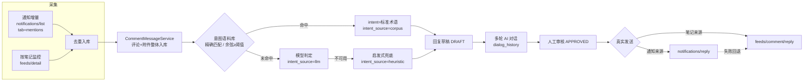

# 评论助手（Comment Assistant）设计与运维

> 作品发布之后的「评论即消息」子系统：采集 → 意图/情感识别 → 关系标签 → 多轮 AI 起草 → 人工审核 → 真实回复，
> 并配套多账号凭据、定时采集、票据健康与预警推送。

---

## 一、定位与边界

| 维度 | 说明 |
|------|------|
| 解决什么 | 发布后的评论区运营：评论从各平台汇入、自动分类打标、AI 起草回复、人审后真实回复；多账号互不串数据 |
| 不解决什么 | 发布本身（由 4 阶段内容流水线负责）；平台侧风控与合规（自建桥负责登录与抓取） |
| 数据来源 | 可插拔：自建桥 `xiaohongshu-mcp`（`preset=xhs-mcp`）/ 第三方数据服务 / 内置模拟数据（开发兜底） |
| 多租户 | 凭据、监控项、评论都带 `owner_id`；跨租户访问返回 403（ADMIN 例外） |

---

## 二、数据模型

```
contentops_comment                评论（消息）主表
  comment_id            内部 ID（xhs-<平台评论ID> 或内容指纹）
  platform_comment_id   平台原始评论 ID（真实回复必需）
  platform / work_id / workflow_id
  author / author_user_id        发送者：昵称 + 平台用户 ID
  content / likes / comment_time 正文 / 点赞 / 时间戳
  reply_to                       楼中楼父评论
  collected_via                  note（按笔记）/ notification（通知）/ mock
  credential_id                  采自哪个账号凭据
  relation                       FAN/FOLLOWING/FRIEND/REGULAR/SELF/STRANGER
  intent / intent_source / intent_score  意图 + 判定来源（corpus/llm/heuristic）+ 相似度
  sentiment / ai_summary / ai_reply / reply_status / dialog_history
  media_count                    0=纯文本，>0=含图/视频（"只看带图"筛选）

contentops_comment_media          评论附件（一条评论可多张）
  media_id / comment_id / media_type(IMAGE|VIDEO) / url / thumb_url / width / height
  sort_order                     同一评论内排序
  owner_user_id / owner_name     附件所属用户（= 评论作者，逐条记录）

contentops_comment_watch          自动采集监控项
  watch_id / owner_id / platform / work_id / credential_id
  xsec_token                     笔记票据（会过期）
  token_state / token_set_at / observed_ttl_days / token_checked_at
  token_notified_state / token_notified_at   预警去重
  auto_analyze / enabled / last_collected_at / last_new_count / total_collected / last_source / last_error

contentops_comment_job_run        每轮采集任务记录（触发方式/作品数/抓取/新增/分析/失败/明细）
contentops_comment_user           评论者关系库（user_key=platform:userId，relation/来源/评论次数/备注）
contentops_intent_corpus          意图语料库（intent/phrase/来源/启用/命中次数）
contentops_platform_credential    平台账号凭据（见第五节）
```

---

## 三、处理链路



关键设计取舍：

- **意图语料库前置**：归一化精确匹配优先（确定性最强），其次本地 BGE 中文嵌入余弦相似度 ≥ 阈值（默认 0.95），
  未命中才交给模型；命中回写 `intent_source=corpus` 与 `intent_score`，便于观察命中率与调阈值。
  向量模型不可用时仍保留语料条目，精确匹配不受影响。
- **发送语义**：真实调用失败**不写 SENT**（保持 APPROVED 可重试）；通知来源优先走 `notifications/reply`（只需 `comment_id`），
  失败再回退笔记页回复；两条都不通时抛出通知侧错误（更贴近真实原因）。
- **通知优先**：通知是账号级增量流，一次请求覆盖所有笔记，且自带 `feed_xsec_token`，发现新笔记会自动纳管为监控项。
- **附件与归属**：附件独立建表，逐条记录 `owner_user_id/owner_name`；评论主表只留 `media_count` 作为紧凑标记。

---

## 四、接口一览（`/api/v1`）

### 评论与采集

| 方法 | 路径 | 说明 |
|------|------|------|
| POST | `/comments/collect` | 采集评论（`workId`、可选 `xsecToken`/`credentialId`），返回 `source`（api/mock）与回退原因 |
| GET | `/comments` | 评论列表：`platform`/`workId`/`intent`/`sentiment`/`relation`/`mediaOnly`/`limit`，一次带回附件明细 |
| GET | `/comments/stats` | 意图/情感统计 |
| GET | `/comments/relations` | 关系分布 + 评论者列表 |
| PUT | `/comments/relations/{userKey}` | 设置关系标签（关注/好友等人工或外部源写入） |
| POST | `/comments/relations/sync-followers` | 同步「新增关注」通知，维护粉丝(FAN)标签 |
| POST | `/comments/analyze-all` · `/{id}/analyze` | 批量 / 单条 AI 分析（意图+情感+摘要+回复草稿） |
| POST | `/{id}/reply/chat` | 多轮 AI 对话（生成回复草稿） |
| POST | `/{id}/approve` · `/{id}/send` | 审核通过 → 真实发送（返回 `sendMode=real|simulated`） |
| PUT | `/{id}/reply` | 人工修改回复内容/状态 |

### 自动采集监控

| 方法 | 路径 | 说明 |
|------|------|------|
| POST/GET | `/comments/watches` | 新增（可选 `credentialId`/`xsecToken`/`autoAnalyze`）/ 列出监控作品 |
| PUT | `/comments/watches/{id}/enabled` | 启用/暂停 |
| PUT | `/comments/watches/{id}/token` | 更新 xsec_token（票据过期后一键修复，状态重置为健康） |
| POST | `/comments/watches/{id}/run` · `/watches/run-all` | 立即采集单个 / 立即执行一轮 |
| POST | `/comments/notifications/collect` | 拉取「评论通知」增量（可指定 `tab`/`credentialId`） |
| GET | `/comments/scheduler` · `/comments/ops-overview` | 调度状态 / 运维总览（轮换·账号健康·票据预警·最近任务） |
| GET | `/comments/source-status` | 数据源诊断（接口是否配置、预设、回复/通知能力） |

### 意图语料库

| 方法 | 路径 | 说明 |
|------|------|------|
| GET/POST | `/comments/intent-corpus` | 列表+概览 / 新增语料 |
| DELETE | `/comments/intent-corpus/{id}` · PUT `/{id}/enabled` | 删除 / 启停 |
| POST | `/comments/intent-corpus/rebuild` | 重建向量缓存 |
| POST | `/comments/intent-corpus/match` | 匹配预览（返回命中结果与近邻分数，用于阈值调优） |
| GET | `/comments/intent-corpus/stats` | 语料概览 + 评论侧意图来源分布（命中率） |

### 平台账号凭据

| 方法 | 路径 | 说明 |
|------|------|------|
| POST/GET | `/platform-credentials` | 新增 / 列表（令牌仅返回掩码） |
| PUT/DELETE | `/platform-credentials/{id}` | 更新（`accessToken` 传空表示不变）/ 删除 |
| POST | `/platform-credentials/{id}/probe` | 探测：桥是否可达 + 账号是否已登录 |
| POST | `/platform-credentials/rotate` | 密钥轮换（ADMIN），返回 `total/rotated/skipped/failed` 报告 |

---

## 五、多账号凭据与密钥轮换

- 一条凭据 = 某租户在某平台的一个账号：`preset`（对接方式）+ `baseUrl`（桥地址）+ `accessToken`（AES-GCM 加密落库）。
- 令牌**出参一律掩码**（`****en-A`）；跨租户访问 403；`owner_id` 为空视为共享凭据。
- 采集/回复/通知都按凭据解析客户端（按凭据深拷贝配置，互不影响、并发安全）；监控项固定绑定 `credentialId`。
- 密钥轮换：密文格式 `enc:v2:<keyId>:<base64(iv|ct|tag)>`；把旧密钥写入 `credential-keys-old`（写法 `keyId=密钥材料`）
  → 调 `POST /platform-credentials/rotate` 重新加密 → 报告 `failed=0` 后即可移除旧密钥。
- 解密失败**显式抛错**（绝不把密文当令牌返回），掩码显示 `****(无法解密)` 并提示补旧密钥。

---

## 六、定时任务与预警

- 调度：`contentops.comment.collect-ms`（默认 10 分钟）；每轮顺序为
  **① 通知增量（按账号并行）→ ② 粉丝标签同步 → ③ 按笔记监控采集**，最后按需推送票据预警。
- 成本与风控：单轮最多 `max-works-per-tick` 个作品、单作品最小间隔 `xiaohongshu.min-interval-seconds`、
  自动分析 `auto-analyze-limit` 条上限、通知并行 `notification-parallelism` + 每账号延迟 `notification-per-account-delay-ms`。
- 票据健康：`token_state`（OK/EXPIRED/ERROR）+ `token_set_at`（首次使用时间）+ `observed_ttl_days`（观测有效期）。
  预警阈值 = `min(token-warn-days, 观测有效期 × 0.8)`，到期前提示更新；更新票据后通知记录自动重置。
- 预警推送：汇总为**一条**消息推送到飞书（交互卡片，带「打开评论助手」直达运维页按钮）/ 企业微信（markdown）。
  去重规则：同状态只提醒一次，超过 `remind-hours` 可重复，状态升级立即提醒。

---

## 七、前端模块（评论助手页）

顶部状态条（账号数 / 监控作品 / 票据待处理 / 账号异常 / 待轮换密钥 / 最近采集）+ 分段控件切换五个模块，
模块与 URL 同步（`?tab=workspace|automation|accounts|quality|ops`），预警卡片按钮直达 `?tab=ops`：

| 模块 | 内容 |
|------|------|
| 评论工作台 | 筛选（作品/意图/情感/关系/只看带图）+ 统计 + 评论列表（含缩略图与关系徽标）+ AI 对话面板 |
| 自动采集 | 调度状态、数据源诊断、监控列表（含票据就地更新）、拉取评论通知 |
| 账号凭据 | 账号增删改、测试连接、设为默认、启停 |
| 意图与关系 | 语料库维护 / 匹配预览 / 命中率分布；关系分布与人工标记 |
| 运维总览 | 轮换状态与一键轮换、账号健康、票据预警清单、立即推送预警 |

---

## 八、配置参考

```yaml
contentops:
  comment:
    enabled: true
    collect-ms: 600000                 # 定时采集间隔
    initial-delay-ms: 30000
    scheduled: true
    source: auto                       # auto | api | mock
    fallback-to-mock: true
    max-works-per-tick: 20
    auto-analyze: true
    auto-analyze-limit: 20
    token-warn-days: 7                 # 票据提前预警天数
    intent-rag:
      enabled: true
      threshold: 0.95                  # 语料库命中阈值（精确匹配不受影响）
      preview-top-k: 5
    relation:
      enabled: true
      regular-threshold: 3             # 评论次数≥阈值判定「常客」
      sync-followers: true
    token-notify:
      enabled: true
      remind-hours: 24
      max-items: 10
    xiaohongshu:
      enabled: false                   # 全局兜底数据源（推荐改用「账号凭据」）
      preset: custom                   # custom | xhs-mcp
      base-url: http://127.0.0.1:18060
      endpoint: ""
      auth-mode: bearer                # bearer | query | ark-sign | none
      access-token: ""
      notification-tab: mentions
      notification-parallelism: 3
      notification-per-account-delay-ms: 300
  web:
    base-url: http://localhost:5173    # 预警消息里的直达链接前缀
  security:
    credential-key: ${CONTENTOPS_SECURITY_CREDENTIAL_KEY:}      # 凭据加密密钥（生产必配）
    credential-key-id: ${CONTENTOPS_SECURITY_CREDENTIAL_KEY_ID:}
    credential-keys-old: ${CONTENTOPS_SECURITY_CREDENTIAL_KEYS_OLD:}  # 轮换期旧密钥
  observability:
    alerts:
      feishu-webhook: ${FEISHU_WEBHOOK:}
      wecom-webhook: ${WECOM_WEBHOOK:}
```

---

## 九、已知限制

| 限制 | 说明与建议 |
|------|------------|
| 官方开放平台无评论 API | `open.xiaohongshu.com` 只开放电商类接口（订单/售后/商品/库存/物流/财务），没有笔记评论接口；真实数据需自建桥或第三方数据服务 |
| 桥不返回评论图片 | 自建桥的 `Comment` 结构不含图片字段，带图评论目前只能拿到文字；附件链路已就绪，源侧补齐即自动生效 |
| 0.95 阈值偏严 | BGE 对同义改写一般落在 0.80–0.90，0.95 实际只命中「近乎逐字相同」；建议下调至 ~0.85 或用面板的匹配预览扩充语料 |
| 关注/好友标签 | 桥只提供「谁关注了我」（connections 通知 → FAN），不提供「我关注/互关」；FOLLOWING/FRIEND 需人工标记或外部关系源写入 |
| 票据与令牌会过期 | xsec_token 会失效（已做提前预警 + 一键更新）；桥的 AUTH_TOKEN 变更后在「账号凭据」里更新即可 |
| 通知是滚动窗口 | 通知列表只保留近期条目，长期未跑可能翻页丢失；建议保持采集间隔 ≤ 10 分钟，历史数据靠按笔记监控兜底 |